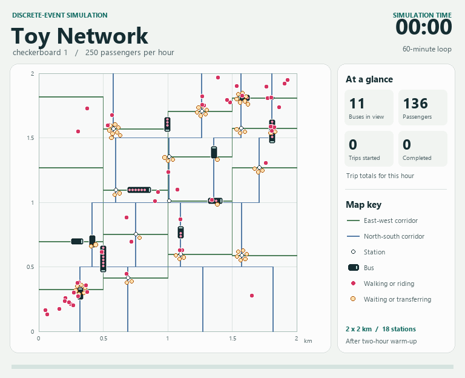

# Bus Network Discretization and Passenger Simulation

[](https://mao2037.github.io/Simulation-for-HetNet/Visualization/)

This standalone project discretizes a continuum bus network, samples passenger origin–destination (OD) trips, builds vehicle schedules, and runs a discrete-event passenger simulation. The two strategies, `earliest` and `shortest`, share the same OD sample, warm-up demand, and schedules. `shortest` restricts eligible vehicles to paths that satisfy its shortest-distance rule.

## Installation and bundled inputs

Use Python 3.9 or later. From this project directory, install the dependencies:

```sh
python -m pip install -r requirements.txt
```

MATLAB must be installed and available as `matlab` on `PATH` for the `network` stage. The remaining stages use Python. The exporter and its MATLAB helper functions are included in `export_discrete_network.m`.

All simulation inputs are local to this project. The six supplied scenarios are `Monocentric`, `Commuter`, `checkerboard1`, `checkerboard2`, `checkerboard3`, and `checkerboard4`. Their supplied parameters are demand 100,000 passengers per hour, `mu=25`, `alpha=0.5`, and city side length 10 km.

## Running experiments

The four stages execute in the order `network`, `od`, `scene`, `simulation`. On the first run, create the network and OD workbooks before using the default schedule-and-simulation command:

```sh
python run_pipeline.py --stages network,od
python run_pipeline.py
python run_pipeline.py --mode single --city Monocentric --rep 1 --stages network,od,scene,simulation
python run_pipeline.py --mode single --city checkerboard1 --replications 10 --stages scene,simulation
python run_pipeline.py --mode single --city Monocentric --rep 1 --stages simulation
```

The default run covers all six scenarios, ten replications per scenario, and up to two worker processes. `RUN_MODE`, `SELECTED_SCENARIOS`, `REPLICATIONS`, `MAX_WORKERS`, and `STAGES` near the top of `run_pipeline.py` control experiment selection. The console reports the total experiment count and each scenario and replication as it starts.

Use `--mode single` with `--city`, `--demand`, `--mu`, `--alpha`, and `--citysize` to select a scenario. `--mode selected` uses `SELECTED_SCENARIOS`. `--rep N` runs only replication N; `--replications N` runs replications 1 through N. `--stages` accepts a comma-separated selection of the four stages.

The `scene` stage requires the matching network workbook. `simulation` requires matching network, OD, and scene workbooks. Missing prerequisites are reported with their paths and required stages. Changing a demand MAT requires regenerating OD. Changing the random seed requires regenerating both OD and scene. Edit `SIMULATION = SimulationConfig(...)` near the top of `run_pipeline.py` to set speeds, capacity, warm-up duration, random seed, and the route-headway threshold for pipeline runs. Vehicle-distance and operating-time cost coefficients are defined near the top of `simulation_common/model_metrics.py`.

## Outputs and statistics

| Directory | Contents |
| --- | --- |
| `outputs/network/` | Discretized routes, segments, stops, and their relationships |
| `outputs/od/` | Formal passengers’ departure times and OD coordinates |
| `outputs/scene/` | Operating routes, periodic schedules, stop times, and phase-coordination audits |
| `outputs/model_metrics/` | Per-replication metrics and scenario summaries |

Per-replication filenames follow `model_metrics_<scenario_key>_cell_conservative_rep_<number>.xlsx`. The `metrics` worksheet has one row per strategy:

| Field | Definition |
| --- | --- |
| `N_k` | Vehicle-distance cost converted to equivalent minutes per formal passenger |
| `N_h` | Operating-time cost converted to equivalent minutes per formal passenger |
| `T_a` | Walking time with weight 2, normalized by formal demand |
| `T_w` | Initial and transfer ordinary waiting, including boarding-stop departure waiting |
| `T_t` | Fixed transfer-connection time, normalized by formal demand |
| `T_r` | In-vehicle time from boarding-stop departure, including intermediate dwell |
| `objective_total` | `N_k + N_h + T_a + T_w + T_t + T_r` |
