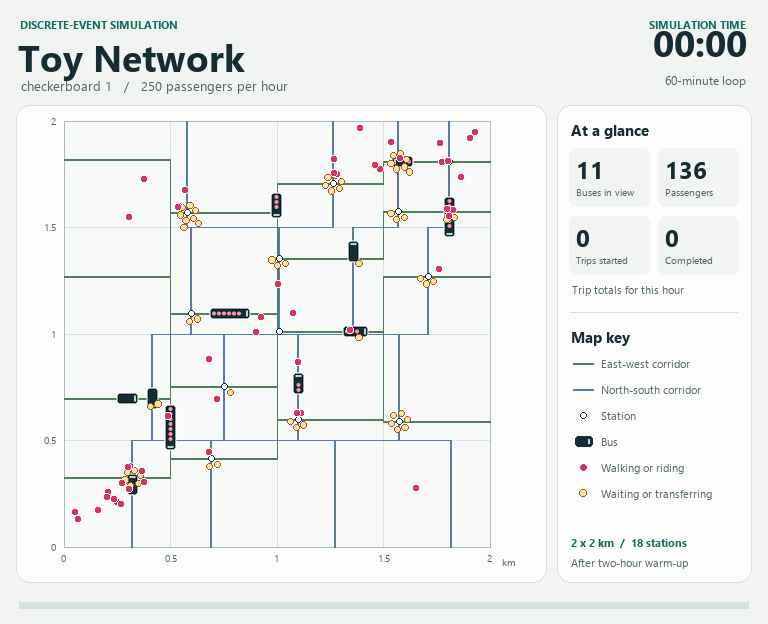

# Bus Network Discretization and Passenger Simulation

[](https://mao2037.github.io/Simulation-for-HetNet/Visualization/)

The pipeline has four stages: network discretization, observation-period origin–destination (OD) sampling, vehicle scheduling, and discrete-event passenger simulation. The `earliest` strategy boards the first eligible vehicle, while `shortest` selects services based on the shortest travel distance. Both strategies use the same OD sample, warm-up demand, and bus schedules.

## Requirements

Use Python 3.9 or later. Install the dependencies from the project directory.

```sh
python -m pip install -r requirements.txt
```

Add MATLAB to `PATH` to export the network. Python runs the remaining stages.

## Running the pipeline

By default, `run_pipeline.py` builds vehicle schedules and runs the passenger simulation for six built-in scenarios, with 10 replications per scenario and up to two worker processes. Each default scenario uses 100,000 passengers per hour, `mu=25`, `alpha=0.5`, and a city side length of 10 km. On the first run, generate the network and OD workbooks before running the default stages. The console displays the total number of runs and reports the run number, scenario, and replication number as each run starts.

```sh
python run_pipeline.py --stages network,od
python run_pipeline.py
python run_pipeline.py --mode single --city Monocentric --rep 1 --stages network,od,scene,simulation
python run_pipeline.py --mode single --city Monocentric --rep 1 --stages simulation
```

Use `--mode single` to run one scenario. Set its parameters with `--city`, `--demand`, `--mu`, `--alpha`, and `--citysize`. Use `--mode selected` to run the scenarios listed in `SELECTED_SCENARIOS` at the top of the script. `--rep N` runs only replication N, while `--replications N` runs replications 1 through N. `--stages` accepts a comma-separated list and executes the selected stages in the order `network`, `od`, `scene`, `simulation`.

The pipeline uses the `cell_conservative` sampling method. For both observation-period and warm-up demand, it selects origin and destination cells using the joint probabilities at the original grid nodes, then samples continuous coordinates within those cells using the four-dimensional interpolated density.

The simulation uses Manhattan walking distances and allows at most one transfer. If the closest boarding and alighting stops cannot be connected within that limit, it searches for a reachable stop pair. To select a transfer stop, it compares the predicted arrival time at the destination stop using the first eligible connecting vehicle at each candidate stop.

The pipeline retains routes whose original headways are strictly below 120 minutes. It redistributes the frequencies of removed routes among the retained routes in the same direction. Vehicle capacity is set to 100,000 passengers. Numerical parameters can be changed in `SimulationConfig` in `simulation_common/core.py`. Regenerate `od` after changing the demand MAT file. Regenerate both `od` and `scene` after changing the random seed.

## Inputs and outputs

The `inputs/` directory contains data for Monocentric, Commuter, checkerboard1, checkerboard2, checkerboard3, and checkerboard4. The four checkerboard scenarios retain the OD and scheduling random streams associated with their original names.

| Directory | Contents |
| --- | --- |
| `inputs/model/` | Continuum model solutions containing `delta_EW`, `delta_NS`, `h_E`, `h_W`, `h_N`, and `h_S` |
| `inputs/demand/<city>/` | Demand MAT files containing `lambda_OD` and `D` for observation-period and warm-up OD sampling |

All data paths are relative to the project directory. The `scene` stage reads the scenario's `network` workbook from `outputs/`. The `simulation` stage reads that `network` workbook and the `od` and `scene` workbooks for the corresponding replication. If a required workbook is missing, the pipeline reports its path and the stage needed to generate it.

To add a scenario, place the matching model and demand MAT files in the corresponding `inputs/` directories and run the required stages. Model files use the name `<city>_demand_<demand>_mu_<mu>_alpha_<alpha>_citysize_<citysize>.mat`. Demand files for the four built-in checkerboard scenarios use `<city>_lambda_<demand>_citysize_<citysize>.mat`. All other demand files use `lambda_<demand>_citysize_<citysize>.mat`.

| Output directory | Workbook contents |
| --- | --- |
| `outputs/network/` | Discretized routes, geometric segments, stops, and their relationships |
| `outputs/od/` | Departure times and origin and destination coordinates for each passenger in the observation period |
| `outputs/scene/` | Operating routes, vehicle schedules, and arrival and departure times at each stop |
| `outputs/model_metrics/` | Per-replication results and scenario means, with one row per strategy |

The `metrics` worksheet contains the strategy identifier and six objective function components. `N_k` and `N_h` are vehicle distance and operating time costs, converted using the value of time to equivalent minutes per passenger in the observation period. `T_a`, `T_w`, `T_t`, and `T_r` are weighted walking time, ordinary waiting time, transfer connection time, and in-vehicle time, respectively, normalized by the number of passengers in the observation period. The four passenger time components are blank if no passenger completes a trip.

After all selected replications for a scenario succeed, the pipeline automatically writes `model_metrics_summary_<scenario_key>_cell_conservative_reps_<count>.xlsx`. The default summary covers 10 replications. For each strategy, it reports the arithmetic mean of each component across replications. If a component is blank in any replication, its mean is blank. Running a single replication with `--rep` writes only its per-replication workbook.

Per-replication metric filenames include `cell_conservative`. Rerunning the same scenario and replication replaces the corresponding workbook. When compatible `network` and `scene` workbooks already exist, use `--stages od,simulation` to generate OD samples and metrics with this sampling method.
